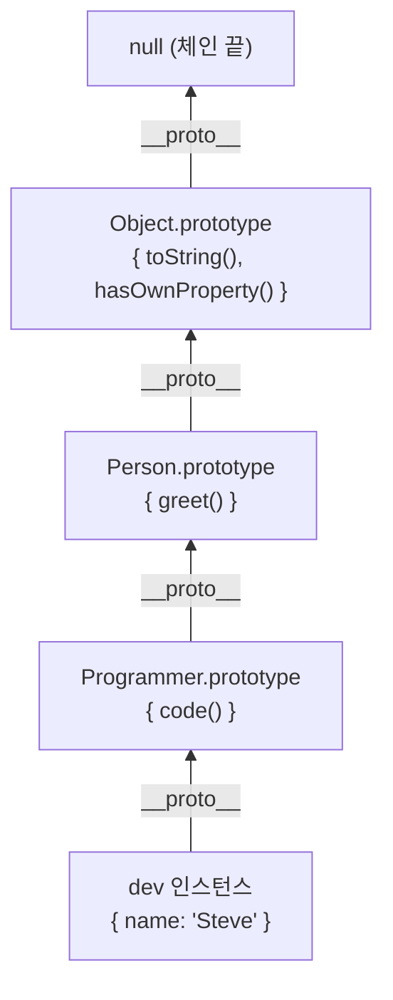

Java나 C++ 같은 클래스 기반(Class-based) 언어에 익숙한 개발자에게 JavaScript의 객체지향 모델은 조금 낯설게 느껴집니다. ES6부터 `class` 키워드가 도입되었지만, **JavaScript의 근본적인 상속 메커니즘은 여전히 프로토타입(Prototype)**에 기반하고 있습니다.

## 객체지향 프로그래밍의 4가지 핵심 원칙

복잡한 소프트웨어를 역할과 책임 단위로 구조화할 때 객체지향 패러다임은 다음 4가지 개념을 중심으로 동작합니다.

- **추상화(Abstraction)**: 복잡한 세부 사항을 숨기고 핵심적인 속성과 동작만 모델링합니다.
- **캡슐화(Encapsulation)**: 내부 상태와 구현을 은닉하고, 외부에는 공개된 인터페이스(메서드)만 노출합니다.
- **상속(Inheritance)**: 상위 객체의 속성과 메서드를 하위 객체가 물려받아 재사용하고 확장합니다.
- **다형성(Polymorphism)**: 같은 메서드 호출이라도 객체의 타입이나 구현에 따라 다르게 동작하도록 만듭니다.

## 프로토타입 기반 상속의 동작 원리

클래스 기반 언어에서는 클래스(설계도)를 복사해 인스턴스를 만들지만, JavaScript에서는 **객체가 다른 객체를 직접 참조(위임, Delegation)** 합니다.

모든 객체는 내부 슬롯 `[[Prototype]]`(접근 시 `Object.getPrototypeOf(obj)`)을 가지며, 자신의 프로퍼티에서 찾지 못한 속성이나 메서드를 프로토타입 체인을 따라 위로 올라가며 탐색합니다.



### 생성자 함수와 프로토타입 메서드 분리

생성자 함수 내부에서 `this.greet = function() { ... }`처럼 메서드를 직접 할당하면, **인스턴스를 만들 때마다 동일한 함수 객체가 메모리에 중복 생성**됩니다. 메서드는 `prototype` 객체에 정의해야 모든 인스턴스가 하나의 함수를 공유합니다.

```js
function Person(name) {
  this.name = name;
}

Person.prototype.greet = function () {
  return `Hello, I am ${this.name}`;
};

function Programmer(name, language) {
  // 1. 부모 생성자 호출로 인스턴스 프로퍼티 초기화
  Person.call(this, name);
  this.language = language;
}

// 2. Object.create로 프로토타입 체인 연결 (불필요한 부모 인스턴스 생성 방지)
Programmer.prototype = Object.create(Person.prototype);
Programmer.prototype.constructor = Programmer;

Programmer.prototype.code = function () {
  return `${this.name} is writing ${this.language}`;
};

const dev = new Programmer("Steve", "TypeScript");
console.log(dev.greet()); // "Hello, I am Steve"
console.log(dev.code());  // "Steve is writing TypeScript"
```

> [!WARNING]
> 과거 코드에서 흔히 쓰이던 `Programmer.prototype = new Person()` 방식은 부모 생성자에 인자가 필요할 때 `undefined`가 전달되거나 불필요한 상태가 프로토타입에 남는 부작용이 있습니다. 프로토타입 연결에는 반드시 `Object.create(Person.prototype)`을 사용해야 합니다.

## ES6 `class`와 캡슐화(`#private`)

ES6의 `class`는 새로운 객체 모델이 아니라, 위의 프로토타입 기반 상속을 훨씬 읽기 쉽고 안전하게 작성할 수 있도록 만든 문법(Syntactic Sugar + 엄격한 규칙)입니다.

```js
class Person {
  constructor(name) {
    this.name = name;
  }

  greet() {
    return `Hello, I am ${this.name}`;
  }
}

class Programmer extends Person {
  #secretKey; // ES2022 private 필드 (진정한 캡슐화)

  constructor(name, language, secretKey) {
    super(name);
    this.language = language;
    this.#secretKey = secretKey;
  }

  // 다형성: 부모의 greet()를 오버라이드
  greet() {
    return `${super.greet()} (${this.language} dev)`;
  }

  hasAccess(key) {
    return this.#secretKey === key;
  }
}

const dev = new Programmer("Steve", "JavaScript", "1234");
console.log(dev.greet());        // "Hello, I am Steve (JavaScript dev)"
console.log(dev.hasAccess("1234")); // true
// console.log(dev.#secretKey);  // SyntaxError: 외부 접근 차단
```

### 생성자 함수 방식과 `class` 문법의 차이

1. `class`는 호이스팅되더라도 초기화 전까지 **TDZ(Temporal Dead Zone)**에 놓이므로 선언 전에 호출할 수 없습니다.
2. `class` 내부 메서드는 자동으로 `strict mode`로 실행되며 열거되지 않습니다(`enumerable: false`).
3. `new` 키워드 없이 호출하면 `TypeError`를 던져 실수를 즉시 잡아줍니다.

## 주의사항: `Object.prototype` 직접 수정 금지

`Object.prototype`은 거의 모든 객체의 최상위 프로토타입이므로, 여기에 임의 메서드를 추가하면 애플리케이션 전체의 `for...in` 루프나 서드파티 라이브러리와 충돌이 발생합니다(이른바 *Prototype Pollution*). 유틸리티 함수는 내장 프로토타입을 확장하기보다 별도의 모듈 함수로 작성해야 합니다.

## 핵심 요약

- JavaScript 객체지향의 본질은 클래스 복사가 아닌 **프로토타입 체인을 통한 위임(Delegation)** 입니다.
- 인스턴스마다 중복 생성되는 것을 막기 위해 메서드는 프로토타입에 정의하며, 실무에서는 이를 안전하게 추상화한 `class`와 `#private` 필드를 활용합니다.
