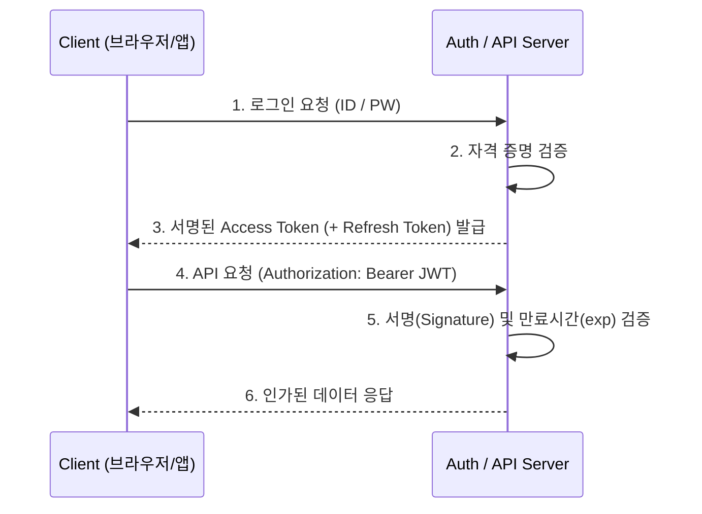

HTTP는 본질적으로 이전 요청의 상태를 기억하지 않는 **무상태(Stateless) 프로토콜**입니다. 따라서 로그인 상태를 유지하려면 매 요청마다 "이 요청을 보낸 사용자가 누구인지" 증명하는 인증 메커니즘이 필요합니다. 전통적인 **세션 기반 인증**과 널리 쓰이는 **JWT(JSON Web Token) 기반 토큰 인증**의 차이를 살펴봅니다.

## 세션 기반 인증 vs 토큰(JWT) 기반 인증

| 비교 항목 | 세션 기반 인증 (Stateful) | 토큰(JWT) 기반 인증 (Stateless) |
| --- | --- | --- |
| **상태 저장 위치** | 서버 메모리 / Redis 등 세션 저장소 | 클라이언트 (서버는 서명만 검증) |
| **수평 확장(Scale-out)** | 공유 세션 스토어(Redis) 또는 Sticky Session 필요 | 비밀키/공개키만 공유하면 어느 서버에서나 검증 가능 |
| **즉시 강제 로그아웃** | **매우 쉬움** (서버에서 세션 삭제) | **어려움** (만료 전까지 토큰 자체는 유효) |
| **네트워크 오버헤드** | 쿠키에는 짧은 Session ID만 전송 | 클레임이 많아지면 토큰 크기가 커져 헤더 부담 증가 |
| **모바일·멀티 도메인** | 쿠키 기반이라 도메인/CORS 제약 관리 필요 | `Authorization: Bearer` 헤더로 어디서든 사용 편리 |

## 토큰 기반 인증의 동작 흐름

> [!NOTE]
> 참고로 쿠키 자체가 브라우저 메모리에만 저장되는 것은 아닙니다. `Max-Age`/`Expires`를 지정하지 않은 **세션 쿠키**는 브라우저 종료 시 삭제되지만, 만료 기간을 명시한 **영구 쿠키(Persistent Cookie)** 는 디스크에 저장되어 브라우저를 껐다 켜도 유지됩니다.

## JWT 기반 인증의 장점

### 1. 서버의 무상태성(Stateless)과 수평 확장성

서버가 개별 사용자의 세션 테이블을 들고 있지 않아도, 요청 헤더에 포함된 토큰의 디지털 서명과 만료 시각만 검증하면 사용자 식별(`sub`, `role` 등)이 가능합니다. 서버가 여러 대로 늘어나더라도 별도의 세션 동기화 DB 조회 없이 독립적으로 인증을 처리할 수 있습니다.

### 2. CSRF 위험 완화 (헤더 전송 시)

브라우저는 쿠키를 매 요청에 자동으로 실어 보내기 때문에 CSRF(사이트 간 요청 위조) 공격에 취약할 수 있습니다. 반면 클라이언트가 JavaScript로 `Authorization: Bearer <token>` 헤더에 토큰을 직접 담아 보내는 구조에서는 타 사이트가 임의로 요청을 보내더라도 인증 헤더가 자동으로 붙지 않아 CSRF 방어에 유리합니다. *(단, 토큰을 쿠키에 저장하는 경우에는 `SameSite` 설정 등 CSRF 대책이 여전히 필요합니다.)*

### 3. 다양한 클라이언트와 표준 OAuth/OIDC 연동

웹 브라우저뿐만 아니라 iOS, Android, 외부 파트너 API, 마이크로서비스 간 인증에서도 HTTP 헤더 표준만으로 손쉽게 검증을 위임할 수 있습니다. OAuth 2.0 및 OpenID Connect(OIDC)의 ID Token 표준 역시 JWT 포맷을 사용합니다.

## 실무에서 놓치기 쉬운 JWT의 한계와 대안

JWT가 만능은 아닙니다. Stateless하다는 장점 뒤에는 반드시 해결해야 할 현실적인 제약이 따릅니다.

1. **즉시 토큰 폐기(Revocation)가 어려움**: 이미 발급된 JWT는 만료 시간(`exp`)이 지나기 전까지 유효합니다. 사용자가 로그아웃하거나 계정이 탈취당해도 서버가 해당 토큰을 즉시 무효화하려면 결국 Redis 블랙리스트 등을 두어야 하며, 이 순간 완전한 Stateless 장점은 일부 희석됩니다.
2. **Access Token + Refresh Token 전략**: 위 문제를 줄이기 위해 실제 API 호출에 쓰는 **Access Token의 수명은 짧게(예: 15분)** 두고, 재발급 전용인 **Refresh Token은 수명을 길게(예: 1~2주) 설정해 `HttpOnly` 쿠키 + DB(Redis)에서 관리**하는 하이브리드 패턴이 표준으로 자리 잡았습니다.
3. **XSS vs CSRF 보안 트레이드오프**: Access Token을 `localStorage`에 두면 XSS 공격에 탈취될 위험이 있고, 쿠키에 두면 CSRF 대응(`SameSite`, `HttpOnly`, `Secure`)이 필요합니다. 서비스 위협 모델에 맞춰 보관 위치를 신중히 선택해야 합니다.

## 다음 편 예고

이어지는 [#2편](/posts/2017-04-15-jwt-2)에서는 JWT를 구성하는 **Header · Payload · Signature의 실제 구조와 Base64Url 인코딩, 그리고 반드시 피해야 할 보안 함정**을 살펴봅니다.
