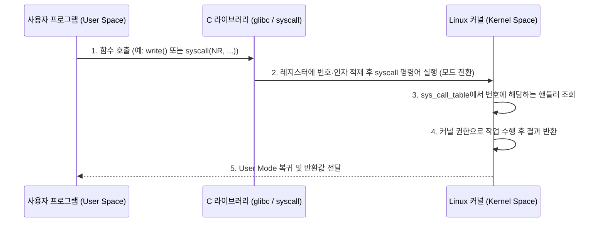

운영체제는 시스템의 안정성과 보안을 지키기 위해 일반 응용 프로그램이 하드웨어나 커널 메모리에 직접 접근하지 못하도록 **사용자 공간(User Space)** 과 **커널 공간(Kernel Space)** 을 엄격히 분리합니다.

응용 프로그램이 파일을 읽거나 네트워크 소켓을 열 때, 커널의 도움을 받아야만 하는 작업을 요청하기 위해 호출하는 공식 인터페이스가 바로 **시스템 콜(System Call)** 입니다.

## 시스템 콜의 동작 흐름



x86_64 아키텍처 기준 새로운 시스템 콜을 리눅스 커널에 직접 추가하려면 크게 5단계를 거칩니다. *(커널 소스 트리는 `/usr/src/linux` 기준입니다.)*

## 1단계: 시스템 콜 테이블 등록 (`syscall_64.tbl`)

x86_64 아키텍처의 시스템 콜 번호와 심볼 매핑은 `arch/x86/entry/syscalls/syscall_64.tbl` 파일에 정의되어 있습니다. 파일 하단의 마지막 공통(`common`) 또는 `64` ABI 번호 다음 번호를 할당합니다.

```text file="arch/x86/entry/syscalls/syscall_64.tbl"
# <number> <abi>    <name>          <entry point>
451        common   cachestat       sys_cachestat
452        common   my_add          sys_my_add
```

> [!NOTE]
> 기존 시스템 콜 번호와 절대 겹치지 않도록 테이블의 마지막 번호를 확인하고, 호출 규약이 64비트/공통인지(`common` 또는 `64`) 맞춰야 합니다.

## 2단계: 시스템 콜 함수 원형 선언 (`syscalls.h`)

커널 전역 헤더 파일인 `include/linux/syscalls.h`에 새 시스템 콜의 함수 프로토타입을 추가합니다.

```c file="include/linux/syscalls.h"
asmlinkage long sys_my_add(long a, long b);
```

- `asmlinkage`는 컴파일러에게 인자를 레지스터/스택 호출 규약에 맞게 전달하도록 지시하는 커널 매크로입니다.

## 3단계: 시스템 콜 구현 (`SYSCALL_DEFINE` 매크로)

커널 소스 디렉터리(예: `kernel/sys.c` 또는 별도 생성한 `kernel/my_add.c`)에 실제 동작 코드를 작성합니다. 현대 Linux 커널에서는 보안과 타입 검증(레지스터 확장 문제 방지)을 위해 함수 직접 정의 대신 **`SYSCALL_DEFINE<인자수>`** 매크로를 사용합니다.

```c file="kernel/my_add.c"
#include <linux/kernel.h>
#include <linux/syscalls.h>

SYSCALL_DEFINE2(my_add, long, a, long, b)
{
    long result = a + b;
    printk(KERN_INFO "[sys_my_add] called with a=%ld, b=%ld -> %ld\n", a, b, result);
    return result;
}
```

별도 파일(`kernel/my_add.c`)로 작성했다면 같은 디렉터리의 `Makefile`에도 빌드 대상을 추가해야 합니다.

```makefile file="kernel/Makefile"
obj-y += my_add.o
```

> [!WARNING]
> 만약 사용자 공간에서 포인터(예: 문자열 버퍼 주소)를 인자로 받는 시스템 콜을 작성한다면, 커널이 해당 주소를 직접 역참조해서는 안 됩니다. 반드시 `copy_from_user()` / `copy_to_user()` 함수를 사용해 사용자 메모리를 안전하게 복사·검증해야 커널 패닉이나 권한 상승 취약점을 막을 수 있습니다.

## 4단계: 커널 빌드 및 설치

수정한 소스를 반영해 커널 이미지와 모듈을 컴파일하고 부트로더에 등록한 뒤 재부팅합니다. *(실습은 반드시 가상머신 환경에서 스냅샷을 찍고 진행하는 것을 권장합니다.)*

```bash
# 현재 실행 중인 커널 설정 복사 후 빌드 준비
cp /boot/config-$(uname -r) .config
make olddefconfig

# CPU 코어 수만큼 병렬 컴파일
make -j$(nproc)
sudo make modules_install
sudo make install

# GRUB 반영 후 재부팅
sudo update-grub
sudo reboot
```

재부팅 후 `uname -r` 명령으로 직접 빌드한 커널 버전이 부팅되었는지 확인합니다.

## 5단계: 사용자 공간 테스트 프로그램 작성 및 검증

커널에 새 시스템 콜을 추가했더라도 표준 `glibc`에는 아직 래퍼 함수가 없으므로, `<unistd.h>`의 `syscall()` 함수를 통해 번호(`452`)로 직접 호출합니다.

```c file="test_my_add.c"
#include <stdio.h>
#include <unistd.h>
#include <sys/syscall.h>

#define SYS_MY_ADD 452

int main(void) {
    long sum = syscall(SYS_MY_ADD, 15L, 27L);
    printf("syscall(SYS_MY_ADD, 15, 27) = %ld\n", sum);
    return 0;
}
```

```bash
gcc -Wall -O2 test_my_add.c -o test_my_add
./test_my_add
# 출력: syscall(SYS_MY_ADD, 15, 27) = 42

# 커널 로그(printk) 출력 확인
dmesg | tail -n 5
```

## 핵심 요약

- 시스템 콜은 사용자 영역에서 커널 영역으로 안전하게 진입하기 위한 **유일한 공식 통로**입니다.
- 새 시스템 콜을 추가할 때는 **테이블 등록(`syscall_64.tbl`) → 헤더 선언(`syscalls.h`) → `SYSCALL_DEFINE` 구현 & `Makefile` 반영 → 커널 빌드 → `syscall()` 호출 테스트** 순서를 따릅니다.
- 사용자 포인터를 다룰 때는 반드시 `copy_from_user` / `copy_to_user`로 경계를 검증해야 합니다.
