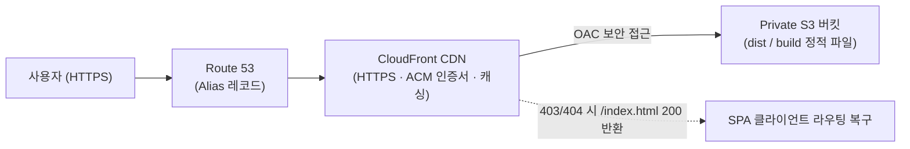

React, Vue, Vite 등으로 만든 프론트엔드 애플리케이션은 최종 빌드 시 정적 파일(`HTML`, `CSS`, `JS`, 이미지)만 남기 때문에 별도의 Node.js 서버 없이도 **AWS S3 + CloudFront** 조합으로 저렴하고 안정적으로 전 세계에 배포할 수 있습니다.

## 전체 배포 아키텍처



과거에는 S3 버킷 자체를 Public으로 열고 "정적 웹사이트 호스팅(Static Website Hosting)" 기능을 켜는 방식을 많이 썼지만, S3 웹사이트 엔드포인트는 HTTPS를 직접 지원하지 못합니다. 실무에서는 **S3 버킷은 비공개(Private)로 유지하고 앞단에 CloudFront + ACM(SSL 인증서)을 두는 구성**이 보안과 성능(CDN 캐싱) 측면에서 표준입니다.

## 1단계: S3 버킷 생성 및 빌드 파일 업로드

1. AWS 콘솔에서 S3 버킷을 생성합니다(예: `my-frontend-app-prod`).
2. **퍼블릭 액세스 차단(Block all public access)** 은 켜진 상태(비공개)로 둡니다. CloudFront의 **OAC(Origin Access Control)** 를 통해서만 S3 객체에 접근하게 만들기 위함입니다.
3. 로컬에서 프론트엔드 프로젝트를 빌드(`npm run build`)해 생성된 `dist/` 또는 `build/` 폴더의 내용을 업로드합니다.

> [!NOTE]
> 만약 CloudFront 없이 순수 **S3 정적 웹사이트 호스팅(HTTP 전용)** 만 테스트 용도로 구성한다면, 버킷을 퍼블릭으로 허용한 뒤 정적 호스팅 옵션에서 **인덱스 문서와 오류 문서를 모두 `index.html`** 로 지정해야 합니다.

## 2단계: CloudFront 배포와 SPA 라우팅 해결

SPA(React Router 등 History API 기반)를 정적 호스팅에 올릴 때 가장 흔히 겪는 문제가 **"메인 페이지는 열리는데 `/posts/1` 같은 하위 경로에서 새로고침하면 `403 Forbidden` 또는 `404 Not Found`가 뜨는 현상"** 입니다.

이는 S3 버킷 안에 `/posts/1`이라는 실제 파일이 없기 때문입니다. CloudFront에서 아래 설정을 추가하면 깔끔하게 해결됩니다.

1. **Origin 설정**: 1단계에서 만든 S3 버킷을 선택하고, **Origin access control(OAC)** 을 생성해 S3 버킷 정책에 CloudFront 접근 권한을 반영합니다.
2. **HTTPS 강제**: Viewer protocol policy를 **`Redirect HTTP to HTTPS`** 로 설정합니다.
3. **ACM SSL 인증서 연결**: 커스텀 도메인(`example.com`, `www.example.com`)을 사용할 경우 AWS Certificate Manager(CloudFront용은 반드시 **`us-east-1` 리전**)에서 발급받은 인증서를 연결합니다.
4. **SPA 에러 페이지 폴백 (핵심)**:
   - CloudFront의 **Error pages** 탭에서 `403`과 `404` 응답에 대한 **Custom Error Response**를 추가합니다.
   - HTTP error code: `403` (및 `404`)
   - Response page path: **`/index.html`**
   - HTTP Response Code: **`200: OK`**

이제 사용자가 `/about`이나 `/posts/1`에서 새로고침해도 S3가 반환한 403/404를 CloudFront가 `/index.html` (200 OK)로 바꿔 응답하므로 클라이언트 라우터가 정상 동작합니다.

## 3단계: Route 53 커스텀 도메인 연결

1. **Hosted Zone 생성**: Route 53에서 보유한 도메인(`example.com`)으로 호스팅 영역을 생성합니다.
2. **레코드 연결**:
   - 루트 도메인(`example.com`): 레코드 유형 **`A`**, **Alias 활성화**, 대상은 **CloudFront 배포** 선택
   - 서브 도메인(`www.example.com`): `A` Alias 또는 `CNAME`으로 CloudFront 도메인 연결 (`www` → 루트 리다이렉트가 필요하면 CloudFront Function 사용)
3. **네임서버(NS) 변경**: 도메인 등록 대행사(가비아, GoDaddy, Namecheap 등)에 Route 53 호스팅 영역에 발급된 NS 레코드 4개를 등록합니다.

## 4단계: AWS CLI를 이용한 배포 자동화와 캐시 전략

매번 콘솔에 파일을 드래그해서 올리지 않고 **AWS CLI**로 빌드 → 동기화 → 캐시 무효화를 한 번에 처리할 수 있습니다. 이때 **해시된 에셋과 `index.html`의 캐시 정책을 분리**하는 것이 중요합니다.

```bash file="deploy.sh"
#!/usr/bin/env bash
set -euo pipefail

BUCKET="s3://my-frontend-app-prod"
DISTRIBUTION_ID="E1234567890ABC"

# 1. 프로덕션 빌드
npm run build

# 2. JS/CSS/이미지 등 해시가 포함된 정적 에셋은 장기 캐시(1년) 적용 후 동기화
aws s3 sync dist/ "$BUCKET" \
  --delete \
  --exclude "index.html" \
  --cache-control "public, max-age=31536000, immutable"

# 3. index.html은 항상 최신 버전을 확인하도록 캐시 비활성화
aws s3 cp dist/index.html "$BUCKET/index.html" \
  --cache-control "no-cache, no-store, must-revalidate"

# 4. CloudFront 엣지 캐시 무효화
aws cloudfront create-invalidation \
  --distribution-id "$DISTRIBUTION_ID" \
  --paths "/index.html"
```

> [!TIP]
> `index.html`만 `no-cache`로 두고 JS/CSS 파일은 파일명 해시(`app.a1b2c3.js`) + `immutable` 장기 캐시로 배포하면, 새 버전을 올렸을 때 사용자가 구버전 HTML을 보거나 캐시 무효화 비용(`/*`)을 과도하게 쓰는 문제를 동시에 방지할 수 있습니다.

## 핵심 요약

- 정적 SPA 배포는 **비공개 S3 + CloudFront(OAC + HTTPS) + Route 53** 조합이 가장 안전하고 빠릅니다.
- History API 라우팅 새로고침 오류는 CloudFront **Custom Error Response (`403`/`404` → `/index.html`, HTTP `200`)** 로 해결합니다.
- 배포 스크립트에서는 `index.html`과 해시된 정적 자산의 `Cache-Control` 헤더를 반드시 구분해 업로드하세요.
