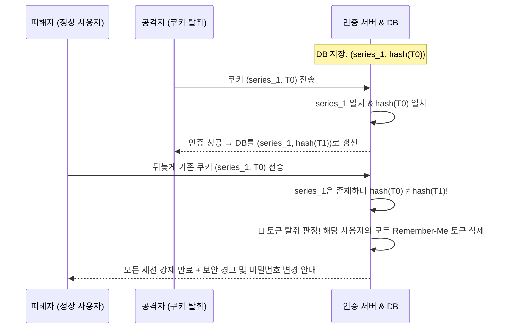

사용자가 매번 아이디와 비밀번호를 다시 입력하지 않아도 로그인을 유지해 주는 **자동 로그인(Remember Me)** 기능은 편리하지만, 영구 쿠키(Persistent Cookie)를 잘못 설계하면 세션 하이재킹에 무방비로 노출됩니다.

단순히 "랜덤 토큰을 쿠키에 저장하고 로그인할 때마다 새 토큰으로 교체(Rotation)한다"는 발상에는 어떤 치명적인 맹점이 있고, 이를 어떻게 보완해야 하는지 살펴봅니다. 이 글은 보안 설계의 고전으로 꼽히는 Charles Miller의 *Persistent Login Cookie Best Practice*와 이후 발전된 탐지 설계를 바탕으로 정리했습니다.

## 1세대 설계: 단일 토큰 로테이션 방식

1. 사용자가 자동 로그인을 선택해 로그인하면 일반 세션 쿠키와 함께 **자동 로그인 쿠키(`username + random_token`)** 를 `HttpOnly; Secure` 속성으로 발급하고 DB에 저장합니다.
2. 세션이 만료된 뒤 사용자가 재방문하면 서버는 쿠키의 `{ username, token }` 쌍을 DB와 대조합니다.
3. 일치하면 사용자를 인증 처리하고, **기존 토큰을 DB에서 삭제한 뒤 새 토큰을 생성해 DB와 쿠키를 갱신(Rotation)** 합니다.
4. **민감 작업 제한**: 자동 로그인만으로 인증된 사용자는 비밀번호 변경, 결제, 회원 탈퇴 등 고위험 작업 전에 비밀번호 재확인을 요구합니다.

### 치명적 허점: 공격자가 먼저 토큰을 사용하면?

이 구조에서 공격자가 피해자의 쿠키(`Token_0`)를 탈취했다고 가정해 봅시다.

1. 공격자가 `Token_0`으로 먼저 접속합니다 → 서버는 정상 사용자로 판단해 `Token_0`을 폐기하고 공격자에게 **`Token_1`을 발급**합니다.
2. 뒤늦게 피해자가 원래 가진 `Token_0`으로 접속합니다 → DB에는 이미 `Token_1`만 있으므로 자동 로그인이 실패합니다.
3. **문제는 피해자의 반응입니다**: 피해자는 단지 "어, 자동 로그인이 풀렸네?" 하고 넘어가며 다시 로그인할 뿐, **자신의 계정이 탈취당한 사실을 전혀 알지 못합니다.** 서버 역시 피해자가 보낸 `Token_0`이 그냥 만료된 쓰레기 값인지, 탈취당한 과거 토큰인지 구분할 수 없습니다.

## 발전된 2세대 설계: `{ Identifier, Token }` 분리와 탈취 탐지

이 문제를 해결하려면 쿠키와 DB에 **고정된 시리즈 식별자(`identifier` / `series`)** 와 **일회성 검증 토큰(`token`)** 을 분리해 저장해야 합니다.

- **`identifier` (시리즈 ID)**: 해당 기기(브라우저)의 자동 로그인 세션을 식별하는 **불변 난수** (토큰 갱신 시에도 유지)
- **`token`**: 매 자동 로그인 재인증마다 새로 교체되는 **일회성 난수**
- **DB 저장 방식**: 비밀번호와 마찬가지로 DB에는 원문 `token` 대신 **`SHA-256(token)` 해시값**을 저장해 DB 유출 시에도 즉시 악용되지 않도록 합니다.

### 정상 재인증 vs 탈취 탐지 시퀀스

왜 이 방식이 탈취를 정확히 잡아낼까요?

- 단순 만료나 로그아웃으로 삭제된 경우라면 DB에 `series_1` 자체가 없습니다.
- 반대로 **DB에 `series_1`은 그대로 있는데 전달된 `token`이 일치하지 않는다는 것**은, **과거에 이 `series_1`을 가진 다른 누군가가 이미 `token`을 사용해 새 토큰(`T1`)으로 갱신해 갔다는 명백한 증거**가 됩니다.

이 시점에 서버는 즉시 해당 계정의 **모든 자동 로그인 토큰을 전부 폐기(Revoke)** 하고, 활성 세션을 끊은 뒤 사용자에게 *"다른 기기에서 비정상적인 로그인 시도가 감지되었습니다"* 라는 경고와 비밀번호 변경 안내를 띄워 피해를 차단할 수 있습니다.

## 현대 인증(Refresh Token Rotation)과의 연결고리

이 원리는 오늘날 OAuth 2.0 / JWT 환경의 **Refresh Token Rotation(RTR) & Reuse Detection(재사용 탐지)** 으로 그대로 이어졌습니다.

- JWT 환경에서도 장기 유지용 **Refresh Token**을 사용할 때, 이미 한 번 사용된 Refresh Token(Token Family 내 과거 세대 토큰)이 다시 들어오면 즉시 토큰 탈취로 간주하고 해당 Token Family 전체를 무효화합니다.

## 구현 시 필수 체크리스트

1. 자동 로그인 쿠키에는 반드시 **`HttpOnly`, `Secure`, `SameSite=Lax`** 속성을 설정하세요.
2. 암호학적으로 안전한 난수 생성기(`crypto.randomBytes(32)`)로 `identifier`와 `token`을 생성하고, DB에는 `token`의 해시값만 보관하세요.
3. "모든 기기에서 로그아웃" 기능을 제공해 사용자가 원할 때 DB의 모든 자동 로그인 레코드를 일괄 삭제할 수 있어야 합니다.
4. 자동 로그인으로 복구된 세션에서는 비밀번호 변경·결제 등 민감 작업 전 **재인증(Step-up Authentication)** 을 요구하세요.
