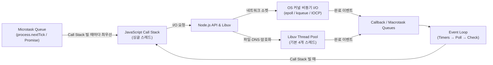

백엔드 기술 면접이나 아키텍처 논의에서 빠지지 않고 등장하는 질문이 있습니다.

> "Node.js는 싱글 스레드라면서, 어떻게 수많은 동시 요청을 막히지 않고 처리할 수 있나요?"

핵심은 **JavaScript 코드가 실행되는 메인 스레드는 하나이지만, 네트워크·파일 같은 I/O 작업은 OS 커널과 Libuv 스레드 풀에 위임해 비동기(Non-blocking)로 처리**하기 때문입니다.

## 블로킹(Blocking) vs 논블로킹(Non-blocking)

전통적인 멀티 스레드 기반 서버(예: 스레드 풀 크기가 고정된 동기 서버)는 요청 1건마다 워커 스레드 1개를 할당합니다. 스레드가 DB 쿼리나 외부 API 응답을 기다리는 동안 대기 상태(Blocked)에 빠지면, 동시 접속이 폭증할 때 스레드 고갈이나 컨텍스트 스위칭 비용이 급격히 증가합니다.

반면 Node.js는 요청을 받으면 I/O 작업을 OS 커널이나 Libuv에 넘긴 뒤 **즉시 제어권을 이벤트 루프로 돌려보내 다음 요청을 받습니다.** 작업이 완료되면 콜백(또는 `Promise`)이 큐에 들어가 차례로 실행됩니다.

## Node.js 비동기 처리 구조



### Event Loop의 주요 실행 순서

1. **Microtask Queue 최우선 처리**: 현재 Call Stack이 비워지면 이벤트 루프의 다음 단계로 넘어가기 전에 `process.nextTick()`과 `Promise.then()` / `async-await` 후속 콜백을 모두 소진합니다.
2. **Timers 단계**: `setTimeout`, `setInterval`의 만료된 콜백 실행
3. **Pending Callbacks**: 지연된 일부 시스템 콜백 실행
4. **Poll 단계**: **새로운 I/O 이벤트를 기다리고 완료된 I/O 콜백 실행** (대부분의 서버 로직이 머무는 핵심 구간)
5. **Check 단계**: `setImmediate()` 콜백 실행
6. **Close Callbacks**: `socket.on('close', ...)` 등 종료 이벤트 처리

```js
console.log("1. sync start");

setTimeout(() => console.log("4. setTimeout (Timers)"), 0);
setImmediate(() => console.log("5. setImmediate (Check)"));

Promise.resolve().then(() => console.log("3. Promise (Microtask)"));
process.nextTick(() => console.log("2. nextTick (Highest Microtask)"));

console.log("1-2. sync end");
```

> [!NOTE]
> `Promise`와 `process.nextTick` 같은 마이크로태스크가 끝나지 않고 재귀적으로 계속 쌓이면 이벤트 루프가 Poll 단계로 넘어가지 못하는 **I/O Starvation(기아 현상)** 이 발생할 수 있으므로 주의해야 합니다.

## Node.js의 강점과 한계

### 강점: I/O 집약적(I/O-bound) 워크로드

웹 API 게이트웨이, 실시간 채팅(WebSocket), BFF(Backend For Frontend), 스트리밍 프록시처럼 **대부분의 시간이 DB 조회·외부 HTTP 호출·네트워크 I/O 대기로 소비되는 서비스**에서 메모리 사용량이 적고 매우 높은 처리량을 보여줍니다.

### 한계: CPU 집약적(CPU-bound) 작업과 동기 함수

JavaScript 코드를 실행하는 메인 스레드는 단 하나입니다. 만약 요청 핸들러 안에서 다음과 같은 작업을 수행하면 **모든 사용자의 요청이 그 작업이 끝날 때까지 멈춥니다.**

- 동기식 API 호출: `fs.readFileSync()`, `crypto.pbkdf2Sync()` (서버 기동 시 초기 설정 외 사용 금지)
- 무거운 CPU 연산: 대용량 이미지 리사이징, 동영상 인코딩, 복잡한 암호화·수치 계산, 수십 MB JSON 직렬화/파싱

```js
// Bad: 서버 요청 핸들러에서 동기 파일 읽기 (전체 이벤트 루프 블로킹)
const data = fs.readFileSync("/path/to/large.json", "utf8");

// Good: Promise 기반 비동기 I/O 사용
import { readFile } from "node:fs/promises";
const asyncData = await readFile("/path/to/large.json", "utf8");
```

### CPU 집약 작업 해결 전략

1. **Worker Threads (`node:worker_threads`)**: CPU 연산이 불가피할 때 별도 스레드로 분리해 메인 이벤트 루프를 보호합니다.
2. **Cluster / PM2 멀티 프로세스**: CPU 코어 수만큼 Node.js 프로세스를 띄워 부하를 분산합니다.
3. **작업 큐(BullMQ 등) + 전용 워커 분리**: 무거운 작업은 메시지 큐에 넣고 별도 마이크로서비스(Go, Rust, Python 등 또는 전용 워커)가 처리하도록 아키텍처를 나눕니다.

## 핵심 요약

- Node.js는 **싱글 스레드 JS 실행 + Libuv/OS 비동기 I/O 위임** 구조로 높은 I/O 동시성을 달성합니다.
- 서버 코드에서는 절대 동기 I/O(`*Sync`)로 이벤트 루프를 막지 말고 `async/await`와 비동기 API를 사용해야 합니다.
- CPU 연산이 주가 되는 작업은 **Worker Threads**나 **별도 워커 프로세스/서비스**로 격리하는 것이 정석입니다.
