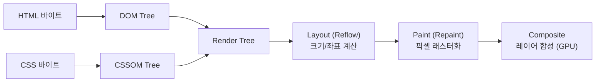

HTML, CSS, JavaScript로 화면을 구현하는 것에서 한 걸음 더 나아가, **"브라우저가 실제로 웹 페이지를 어떤 순서로 화면에 그리는가?"**를 이해해야 체감 성능을 끌어올리는 최적화가 가능합니다.

일반적인 디스플레이는 초당 60회(60fps, 약 16.6ms마다 1프레임) 또는 120Hz 주사율로 화면을 갱신합니다. JavaScript 실행이나 레이아웃 계산이 16.6ms를 넘기면 프레임이 누락되어 화면이 버벅거리는 **Jank(쟁크)** 현상이 발생합니다.

## 주요 렌더링 엔진

- **Blink**: Chrome, Edge, Opera, Whale 등 Chromium 계열 브라우저 (2013년 WebKit에서 분기)
- **WebKit**: Safari 및 iOS 내 모든 브라우저 엔진
- **Gecko**: Firefox

세부 구현은 다르지만 HTML/CSS를 파싱해 화면을 그리는 핵심 흐름인 **Critical Rendering Path(CRP, 중요 렌더링 경로)**의 원리는 동일합니다.

## Critical Rendering Path (CRP) 전체 흐름

### 1. HTML 파싱과 DOM 생성

브라우저는 네트워크로부터 받은 HTML 바이트 데이터를 문자 → 토큰 → 노드 순서로 변환해 계층 구조인 **DOM(Document Object Model) Tree**를 만듭니다.

HTML을 위에서 아래로 파싱하던 중 `<script>` 태그를 만나면 브라우저는 DOM 생성을 잠시 멈추고(Parser Blocking) 스크립트를 다운로드·실행합니다. 스크립트가 DOM을 수정할 수 있기 때문입니다.

> [!TIP]
> 렌더링을 막지 않으려면 `<script>`에 **`defer`** 또는 **`async`** 속성을 사용하세요.
> - `defer`: HTML 파싱과 병렬로 다운로드한 뒤, DOM 파싱이 완료된 후 **작성 순서대로** 실행 (대부분의 앱 스크립트에 권장)
> - `async`: 병렬 다운로드 후 준비되는 즉시 HTML 파싱을 멈추고 실행 (독립적인 분석/광고 스크립트용)

### 2. CSS 파싱과 CSSOM 생성

HTML 파싱 중 `<link rel="stylesheet">`를 만나면 CSS를 내려받아 스타일 규칙을 트리 형태로 해석한 **CSSOM(CSS Object Model)** 을 구축합니다.

CSS는 부모 스타일이 자식에게 상속·계단식 적용(Cascading)되기 때문에, 전체 CSS가 파싱되기 전까지는 화면을 그릴 수 없습니다. 따라서 CSS는 **렌더링 차단 리소스(Render-blocking Resource)** 로 취급됩니다.

### 3. Render Tree 구성

DOM Tree와 CSSOM Tree를 결합해 **화면에 실제로 표시될 노드만 담은 Render Tree**를 생성합니다.

- `<head>`, `<meta>`, `<script>`처럼 시각적 출력이 없는 요소는 제외됩니다.
- `display: none`이 적용된 요소는 Render Tree에서 **완전히 제외**됩니다.
- 반면 `visibility: hidden`이나 `opacity: 0`은 화면에 보이지 않더라도 공간을 차지하므로 **Render Tree에 포함**됩니다.

### 4. Layout (Reflow)

Render Tree의 각 노드가 뷰포트 안에서 **어느 위치에, 어떤 크기(너비·높이·여백)** 로 배치될지 기하학적 좌표를 계산하는 단계입니다. 이 과정이 다시 일어나는 것을 **Reflow(리플로우)** 라고 부릅니다.

### 5. Paint (Repaint)

계산된 박스 위에 텍스트, 색상, 테두리, 그림자 등 실제 시각적 스타일을 픽셀(비트맵)로 채우는 단계입니다. 레이아웃 변경 없이 색상·배경 등만 바뀌면 Layout을 건너뛰고 **Repaint(리페인트)** 만 수행됩니다.

### 6. Composite (합성)

Paint가 완료된 여러 레이어(Layer)를 GPU가 올바른 순서(z-index 등)로 합쳐 최종 화면을 출력합니다.

## 렌더링 성능 최적화 핵심 원칙

CSS 속성을 변경할 때 어떤 파이프라인 단계가 다시 실행되는지에 따라 비용 차이가 큽니다.

| 변경하는 CSS 속성 | 실행되는 파이프라인 단계 | 비용 |
| --- | --- | --- |
| `width`, `height`, `margin`, `top`, `left`, `font-size` | **Layout → Paint → Composite** | 가장 높음 |
| `color`, `background-color`, `box-shadow`, `border-radius` | **Paint → Composite** | 중간 |
| `transform`, `opacity` | **Composite만 실행 (GPU 가속)** | 가장 낮음 |

### 1. 애니메이션은 `transform`과 `opacity`로 구현하기

요소를 움직일 때 `top`/`left` 대신 `transform: translate3d()`나 `transform: translate()`를 사용하면 Layout과 Paint를 건너뛰고 GPU 합성만 수행하므로 60fps를 안정적으로 유지할 수 있습니다.

### 2. 불필요한 CSS 선택자 깊이와 강제 동기 레이아웃 줄이기

- DOM 깊이가 너무 깊거나 CSS 선택자가 지나치게 복잡하면 스타일 재계산(Recalculate Style) 비용이 커집니다.
- JavaScript에서 `style`을 바꾼 직후 `offsetWidth`/`scrollTop`을 읽는 **Layout Thrashing**을 피하고 읽기/쓰기를 분리하세요. ([JavaScript 성능 최적화 가이드 참고](/posts/2017-07-10-javascript-perfomance-optimization))

### 3. CSS는 `<head>` 상단에, 불필요한 리소스는 조건부 로드

초기 화면(Above the Fold) 렌더링에 필요한 핵심 CSS는 상단에 배치하고, 인쇄용 스타일(`media="print"`) 등은 미디어 쿼리를 지정해 초기 렌더링 차단을 막아야 합니다.

## 핵심 요약

- 브라우저는 **DOM + CSSOM → Render Tree → Layout → Paint → Composite** 순서로 화면을 그립니다.
- 가장 비싼 단계는 **Layout(Reflow)** 이며, 가장 가벼운 단계는 **Composite**입니다.
- `<script defer>`, 최소화된 초기 CSS, `transform`/`opacity` 중심 애니메이션이 CRP 최적화의 핵심입니다.
