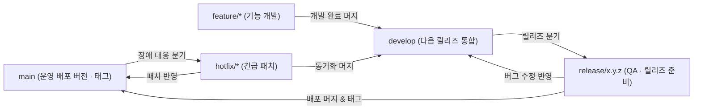

혼자 코드를 작성할 때는 `main` 브랜치 하나만으로 충분할 수 있지만, 팀원이 늘어나고 여러 기능을 동시에 개발하면서 긴급 버그 패치까지 병행해야 하면 코드 충돌과 배포 사고를 막기 위한 **Git 브랜치 전략(Branching Strategy)** 이 필수입니다.

대표적인 세 가지 전략인 **Git Flow**, **GitHub Flow**, **Trunk-Based Development** 의 구조와 어떤 팀 환경에 적합한지 비교합니다.

## 1. Git Flow — 명확한 릴리즈 주기를 위한 전통적 전략

Vincent Driessen이 제안한 모델로, 모바일 앱이나 온프레미스 패키지 소프트웨어처럼 **버전 단위의 계획된 릴리즈와 엄격한 QA 절차가 필요한 환경**에 잘 맞습니다.

### 5가지 브랜치 역할

- **`main`**: 실제 프로덕션에 배포된 안정 버전을 유지하며, 배포 시마다 버전 태그(`v1.2.0`)를 남깁니다.
- **`develop`**: 다음 릴리즈를 위한 개발 통합 브랜치입니다.
- **`feature/*`**: 개별 기능을 개발할 때 `develop`에서 분기하고, 완료 후 `develop`으로 머지한 뒤 삭제합니다.
- **`release/*`**: `develop`에서 배포 후보를 분리해 최종 버그 수정·문서화·버전 범프를 수행합니다. 완료 후 `main`과 `develop` 양쪽에 모두 머지합니다.
- **`hotfix/*`**: 운영 중인 `main`에서 긴급 장애가 발생했을 때 즉시 분기해 수정하고, `main`과 `develop` 모두에 반영합니다.

> [!NOTE]
> 브랜치가 5종류로 나뉘어 안정성이 높지만, 수시로 배포하는 웹 SaaS나 CI/CD 환경에서는 브랜치 관리·머지 오버헤드가 지나치게 무겁다는 단점이 있습니다.

## 2. GitHub Flow — 지속적 배포(CD)를 위한 심플한 전략

GitHub에서 사용하는 단순화된 전략으로, **언제든 배포 가능한 단일 기본 브랜치(`main`)와 작업용 토픽 브랜치** 두 축으로만 운영합니다.

1. `main` 브랜치는 **항상 빌드·테스트가 통과되어 즉시 배포 가능한 상태**로 유지합니다.
2. 새 기능 개발이나 버그 수정은 모두 `main`에서 의미 있는 이름의 브랜치(`feat/oauth-login`, `fix/header-scroll`)를 분기해 작업합니다.
3. 작업 중에도 수시로 Pull Request(PR)를 열어 코드 리뷰와 자동 CI 테스트를 돌립니다.
4. 리뷰 승인과 CI 통과가 끝나면 `main`으로 머지하고 즉시 프로덕션에 배포합니다.

## 3. Trunk-Based Development — 빠른 통합과 CI/CD 극대화

대규모 웹 서비스 팀이나 고빈도 배포 조직이 선호하는 방식으로, 모든 개발자가 **단일 트렁크(`main`)를 향해 아주 작은 단위의 변경을 하루에도 여러 번 직접 또는 극히 짧은 수명의 브랜치(1~2일 이내)** 로 통합합니다.

- 장기간 살아있는 `feature` 브랜치에서 발생하는 **대규모 머지 충돌(Merge Hell)을 원천 차단**합니다.
- 아직 완성되지 않은 기능은 **Feature Flag(기능 토글)** 로 감싸 비활성화 상태로 `main`에 먼저 머지함으로써 배포와 기능 오픈 시점을 분리합니다.

## 한눈에 보는 브랜치 전략 비교

| 비교 항목 | Git Flow | GitHub Flow | Trunk-Based Development |
| --- | --- | --- | --- |
| **핵심 브랜치** | `main`, `develop`, `feature`, `release`, `hotfix` | `main`, `feature/*` | `main` (단일 트렁크 + 단명 브랜치) |
| **배포 주기** | 계획된 주기별 릴리즈 (주/월 단위) | PR 머지 시 수시 배포 | 하루 수회 이상 초고빈도 배포 |
| **머지 충돌 위험** | 브랜치가 오래 살아있을수록 높음 | 낮음~중간 | 매우 낮음 |
| **필수 전제 조건** | 철저한 버전 관리 및 릴리즈 매니저 | PR 리뷰 문화 및 자동화 CI | 강력한 자동 테스트 + **Feature Flag** |
| **적합한 프로젝트** | 앱스토어 심사 앱, 다중 버전 패키지 SW | 대부분의 웹 서비스, 스타트업, 오픈소스 | 성숙한 CI/CD를 갖춘 SaaS·마이크로서비스 |

## 핵심 요약

- 모든 팀에 무조건 좋은 하나의 브랜치 전략은 없습니다. **릴리즈 주기와 CI/CD 자동화 수준**에 맞춰 선택해야 합니다.
- 웹 서비스나 애자일 팀이라면 **GitHub Flow**로 가볍게 시작하고, 배포 빈도가 높아질수록 Feature Flag와 결합한 **Trunk-Based Development** 방향으로 발전시키는 것이 가장 실용적입니다.
