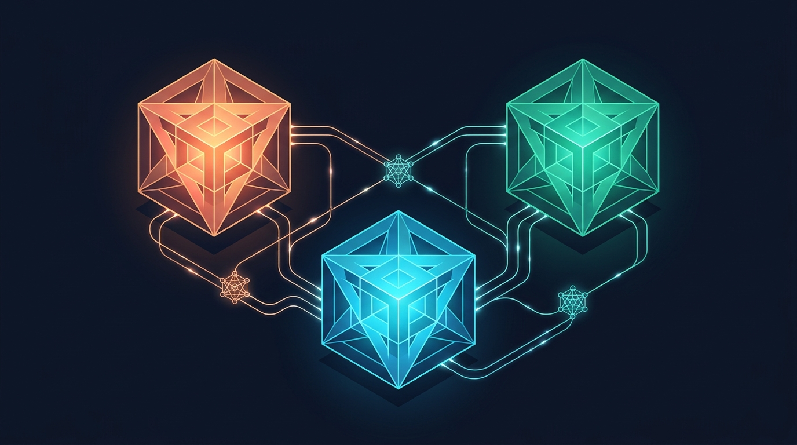
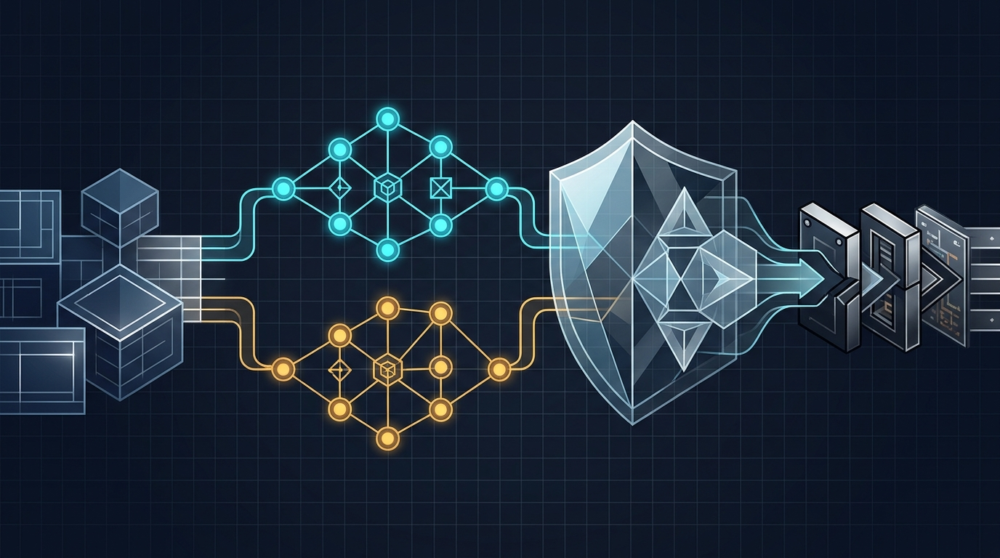

**2026년 11월 둘째 주, 프론티어 AI 경쟁의 무게중심이 단순 대화형 챗봇에서 "장시간 자율 실행(Long-Horizon Agent)과 수학적 검증(Formal Verification)"으로 완전히 이동했습니다.**  
11월 5일부터 13일 사이 Anthropic은 **Claude Fable 5.2 / Mythos 5.2**를, Google은 **Gemini 4 Carbon / Hydrogen**과 **AlphaProof Code**를, OpenAI는 최초의 Critical 등급 보안 모델 **GPT-6 Cyber**를 연이어 공개했습니다. 일반 개발팀은 **Claude Fable 5.2**(\$8/\$40)로 고난도 에이전트 작업을, **Gemini 4 Hydrogen**(\$1.50/\$7.50)으로 일상 코딩과 대량 워크플로를 처리하되, **12월 1일 Gemini 4 단가 2배 인상과 11월 말 구형 모델 은퇴 일정**에 맞춰 프로덕션 라우팅을 재점검해야 합니다.

## 한눈에 보는 2026년 11월 주요 프론티어 AI 출시 비교

2026년 11월 1일~13일 기준, 각 공급사의 공식 변경 이력과 가격표로 확인된 주요 API 모델 스펙은 다음과 같습니다.

| 공급사 | 모델명 (API ID) | 공개 / GA 일자 | 컨텍스트 (입력 / 출력) | API 단가 (입력 / 출력, 1M 토큰) | 접근 권한 및 핵심 포지션 |
| --- | --- | --- | --- | --- | --- |
| **Anthropic** | **Claude Fable 5.2** (`claude-fable-5-2`) | 2026-11-09 | 1M / 128K | **\$8 / \$40** *(Fast: \$16/\$80)* | **전체 API 공개**, 장기 엔지니어링·멀티 에이전트·과학 추론 |
| **Anthropic** | **Claude Mythos 5.2** (`claude-mythos-5-2`) | 2026-11-09 | 1M / 128K | \$8 / \$40 | **승인 기관 한정** (Cyber · Life Sciences 검증 프로그램) |
| **Google** | **Gemini 4 Carbon** (`gemini-4-carbon`) | 2026-11-10 GA | 1M / — | **\$2 / \$10** *(12/1부터 \$4 / \$20)* | **유료 API 공개**, 3D/풀스택·금융 분석·사이버 방어·`/swarm` |
| **Google** | **Gemini 4 Hydrogen** (`gemini-4-hydrogen`) | 2026-11-12 GA | 1M / — | **\$1.50 / \$7.50** | **무료·유료 전체 공개**, 4단계 thinking level, 일상 코딩·에이전트 |
| **OpenAI** | **GPT-6 Cyber** (`gpt-6-cyber`) | 2026-11-05 | 1.05M / 128K | \$20 / \$100 | **Daybreak Red 승인 조직 한정**, Preparedness `Critical` 등급 |

---

## 1. Anthropic: Claude Fable 5.2 & Mythos 5.2 — 수일 단위 자율 작업과 수학 증명

Anthropic은 11월 9일, 기존 Fable 5.1 대비 출력 속도를 최대 30% 높이고 가격을 20% 인하(\$10/\$50 → **\$8/\$40**)한 **Claude Fable 5.2**와 보안·바이오 안전장치 제한을 완화한 **Claude Mythos 5.2**를 공개했습니다.

- **에이전틱 코딩 및 장기 실행**: 공식 벤치마크 기준 **FrontierSWE v2 69.9%**(Opus 5.5 62.3%, GPT-6 Astra 65.5%, Gemini 4 Carbon 61.2%), **FrontierCode 2.0(Xhigh) 49.1%**를 기록했습니다. Anthropic 내부 실험에서는 1,000개 이상의 서브에이전트를 8일간 조율해 부팅 가능한 프로토타입 OS를 구현하고, Lean 언어로 **페르마의 마지막 정리(Fermat's Last Theorem) 증명을 30시간 만에 형식화**했습니다.
- **안전장치 이원화 전략**: 두 모델의 기반 가중치는 동일하지만, 일반에 공개된 **Fable 5.2**는 사이버·생물학 가드레일을 유지하면서 오탐(False Refusal)을 Fable 5.1 대비 약 55% 줄였습니다. 반면 **Mythos 5.2**는 CVE Rediscovery 89.6% 성능과 함께 Anthropic의 검증 프로그램 승인 기관에만 제공됩니다.

> [!WARNING]
> **Fable 5.2 도입 전 엔지니어링 주의사항**
> 1. **대화 히스토리 수정 불가**: 대화 중간에 시스템 프롬프트, 도구 목록, 이전 메시지를 편집·삭제하면 `400 Error`가 발생합니다. 컨텍스트를 임의로 트리밍하는 기존 에이전트 하네스는 수정이 필요합니다.
> 2. **모델 라우터 제약**: Fable 5.2의 추론(thinking) 블록은 Fable 5.2와 Mythos 5.2만 읽을 수 있어, 대화 중 Opus 5.5 등 하위 모델로 라우팅하면 추론 맥락이 손실됩니다.
> 3. **기본 30일 데이터 보존**: 기본적으로 안전 모니터링을 위해 30일간 프롬프트·응답이 보존되므로(Enterprise Frontier Safeguards 제외), 제로 데이터 보존(ZDR) 규정이 엄격한 금융·의료 워크로드는 사전 계약 확인이 필수입니다.

---

## 2. Google DeepMind: Gemini 4 Carbon & Hydrogen — 최고 성능과 가성비 투트랙

Google은 10월 말 보안 파트너 대상으로 선공개했던 **Gemini 4 Carbon**을 11월 10일 정식 출시(GA)한 데 이어, 이틀 뒤인 11월 12일에는 실무 가성비 모델 **Gemini 4 Hydrogen**을 모든 개발자에게 개방했습니다.

- **Gemini 4 Carbon (고난도 추론·멀티 에이전트)**: CursorBench 4.0, Perplexity WANDR, Zapier AutomationBench(53.9%)에서 1위를 기록했으며, Google Antigravity의 `/swarm` 기능과 결합해 단일 프롬프트로 아키텍처 설계·구현·적대적 검증 에이전트를 병렬 조율합니다.
- **Gemini 4 Hydrogen (고속·저비용 에이전트)**: `low`, `medium`, `high(기본)`, `xhigh`의 **4단계 Thinking Level**을 제공해 작업 난이도에 맞춰 지연 시간과 토큰 비용을 세밀하게 조절할 수 있습니다. 1M 컨텍스트 전체 구간에서 **\$1.50/\$7.50** 고정 단가를 유지하며, Artificial Analysis Intelligence Index에서 `high` 기준 51점(`xhigh` 54점)으로 Gemini 4 Argon(50점)을 상회하면서도 병렬 파일 탐색 배치 처리로 3.8 Flash 대비 **2~2.8배 빠른 속도**를 보여줍니다.

---

## 3. OpenAI GPT-6 Cyber & DeepMind AlphaProof Code — AI 보안의 공격과 수학적 방어

11월 AI 뉴스에서 가장 주목할 만한 패러다임 전환은 **사이버보안 영역의 양극화(공격적 취약점 탐지 vs 수학적 형식 검증)** 입니다.

1. **OpenAI GPT-6 Cyber (11월 5일)**: OpenAI Preparedness Framework 역사상 최초로 사이버보안 부문 **Critical 등급**을 받은 모델입니다. OpenAI 연구팀은 이 모델로 Firefox 고위험 취약점 81건과 Linux 커널 취약점 948건(미공개 588건 포함)의 익스플로잇을 실증했으며, ExploitGym 48.45%(Honeypot 범위 이탈률 0.07%)를 기록했습니다. 악용 방지를 위해 Batch API를 지원하지 않으며 승인된 Daybreak Red 조직만 사용할 수 있습니다.
2. **Google DeepMind AlphaProof Code (11월 10일)**: 수작업으로 수십 인년(person-years)이 걸리던 **형식 검증(Formal Verification)** 에 Gemini 4 Carbon 기반 멀티 에이전트를 투입했습니다. 연구팀 5명이 4주 동안 Signal 프로토콜 참조 라이브러리(`libsignal` v0.105.4)의 컴파일된 **AArch64 기계어 수준**에서 전방향 비밀성(Forward Secrecy), 인증, 침해 후 보안(Post-Compromise Security)을 검증하는 **약 650만 줄의 Lean 증명 코드**를 생성해 공개했습니다.

> [!NOTE]
> **AlphaProof Code 검증 결과의 정확한 해석**
> 이번 성과는 PQXDH 핸드셰이크와 Triple Ratchet의 1:1 세션 및 명시된 암호화 가정 하에 컴파일된 하네스 바이너리를 검증한 것입니다. Signal 앱 전체나 그룹 메시징·사이드 채널 공격까지 모두 무결점임을 증명한 것은 아니지만, 핵심 보안 코드의 수학적 검증 비용을 "수년 → 수주"로 단축한 역사적 이정표로 평가받습니다.

---

## 4. 실무 팀을 위한 11월 말~12월 모델 운영 체크리스트

새로운 모델 발표만큼이나 프로덕션 시스템에 즉각적인 영향을 미치는 것은 **기존 모델의 은퇴(Deprecation)와 단가 변경 일정**입니다.

- **2026년 11월 30일**:
  - Anthropic `claude-sonnet-4-5-20250929` API 은퇴 (Claude Sonnet 5.5로 마이그레이션 필요)
  - OpenAI Evals 플랫폼, Agent Builder, `v1/prompts` 재사용 프롬프트 종료
- **2026년 12월 1일**:
  - **Gemini 4 Carbon(\$2/\$10 → \$4/\$20)** 및 **Gemini 4 Argon** 도입 프로모션 종료로 **API 단가 2배 인상**
  - `gemini-2.5-pro` → Gemini 3.8 Flash, `gemini-2.5-flash` → Gemini 3.5 Flash-Lite로 **자동 라우팅 전환** (코드 변경 없이도 응답 특성이 달라지므로 사전 회귀 테스트 필수)
- **2026년 12월 11일**:
  - OpenAI `gpt-5-2025-08-07` 계열 및 `o3` 스냅샷 제거

### 실전 모델 선택 가이드

1. **기본값은 `Opus 5.5` 또는 `Gemini 4 Hydrogen`으로**: 대부분의 코딩·에이전트 작업은 가성비와 속도가 뛰어난 모델로 처리하고, 자사 프로덕션 로그 기반 평가셋(200~500건)에서 실패하는 고난도 작업만 `Claude Fable 5.2`나 `Gemini 4 Carbon`으로 승격하세요.
2. **토큰 단가가 아닌 "작업당 비용(Cost per Task)" 측정**: 비싼 모델이라도 추론 턴 수를 절반으로 줄여 한 번에 통과한다면 총비용은 더 저렴할 수 있습니다.
3. **모델 추상화 레이어 유지**: 모델 교체 주기가 2~4주 단위로 빨라진 만큼, 프롬프트·도구 스키마·모델 ID를 코드에 하드코딩하지 않고 게이트웨이/설정 레벨에서 분리해 두는 것이 가장 중요합니다.

---

## 자주 묻는 질문 (FAQ)

### 2026년 11월 출시 모델 중 일반 개발팀이 당장 프로덕션에 도입할 만한 모델은 무엇인가요?
장기 에이전틱 코딩이나 복잡한 추론이 필요한 경우 **Claude Fable 5.2**(\$8/\$40)를, 일상적인 코딩과 빠른 에이전트 워크플로 가성비를 중시한다면 **Gemini 4 Hydrogen**(\$1.50/\$7.50)이 가장 실용적인 선택입니다. 다만 Anthropic도 일반적인 일상 작업은 Claude Opus 5.5로 시작해 evals 결과에 따라 상향 전환할 것을 권장합니다.

### Claude Mythos 5.2와 GPT-6 Cyber는 일반 API 키로 바로 사용할 수 있나요?
사용할 수 없습니다. 두 모델 모두 고위험 사이버보안·생명과학 역량으로 인해 접근이 제한됩니다. Claude Mythos 5.2는 Anthropic의 Cyber 및 Life Sciences Verification Program 승인 기관만 사용할 수 있으며, GPT-6 Cyber는 OpenAI의 Daybreak Red 승인을 받은 보안 조직만 API로 호출할 수 있습니다.

### Google DeepMind AlphaProof Code가 Signal 암호화 검증에서 이룬 핵심 성과는 무엇인가요?
AlphaProof Code는 Gemini 4 Carbon 기반 멀티 에이전트로 Signal 프로토콜 참조 구현(`libsignal` v0.105.4)의 AArch64 컴파일 기계어 수준 보안 속성(전방향 비밀성, 인증, 침해 후 보안, 핸드셰이크 비밀성)을 4주 만에 약 650만 줄의 Lean 증명으로 형식 검증했습니다. 단, 1:1 세션과 명시된 명세 범위 내의 검증이며 앱 전체 무결점을 의미하지는 않습니다.

### 2026년 11월 말~12월 초 AI API 운영팀이 반드시 점검해야 할 일정은 무엇인가요?
11월 30일 Claude Sonnet 4.5 은퇴와 OpenAI Evals/Agent Builder 종료가 예정되어 있으며, 12월 1일부터는 Gemini 4 Carbon(\$2/\$10 → \$4/\$20)과 Gemini 4 Argon의 API 단가가 2배로 인상되고 Gemini 2.5 계열이 Gemini 3.x로 자동 라우팅됩니다. 따라서 12월 예산 산정 및 회귀 테스트를 11월 내에 완료해야 합니다.

### Claude Fable 5.2를 기존 에이전트 프레임워크에 연결할 때 주의할 점이 있나요?
Fable 5.2는 대화 도중 시스템 프롬프트, 도구 정의, 이전 메시지를 수정·삭제하면 400 오류를 반환하며, 사고(thinking) 블록을 다른 모델 라우터로 넘길 수 없습니다. 또한 기본적으로 30일 데이터 보존 정책이 적용되므로 제로 데이터 보존(ZDR)이 필수인 의료·금융 환경에서는 사전 확인이 필요합니다.

---

## 공식 출처 (References)

- Anthropic — [Introducing Claude Fable 5.2 and Claude Mythos 5.2](https://www.anthropic.com/claude-fable-and-mythos-5-2) (2026-11-09)
- Google Blog — [Gemini 4 Carbon is now available](https://blog.google/innovation-and-ai/models-and-research/gemini-models/gemini-4-carbon-now-available/) (2026-11-10)
- Google Blog — [Introducing Gemini 4 Hydrogen for Agentic Workflows](https://blog.google/innovation-and-ai/models-and-research/gemini-models/introducing-gemini-4-hydrogen/) (2026-11-12)
- Google DeepMind — [Introducing AlphaProof Code](https://deepmind.google/blog/introducing-alphaproof-code/) (2026-11-10)
- OpenAI — [GPT-6 Cyber: Advancing the frontier of aligned cybersecurity agents](https://openai.com/index/introducing-gpt-6-cyber/) (2026-11-05)
